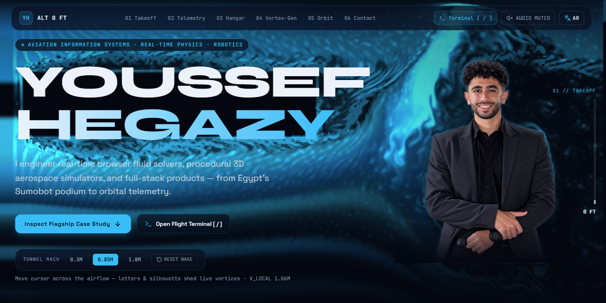
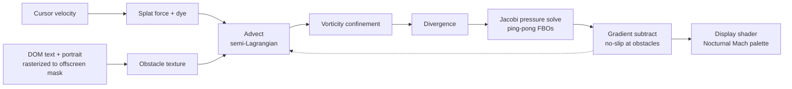

<a href="https://youssev.vercel.app">
  
</a>

<h1 align="center">Youssef Hegazy · Portfolio</h1>

<p align="center">
  An aerospace-themed portfolio where the hero is a <b>real-time GPU Navier-Stokes wind tunnel</b>.<br>
  My name and portrait are solid obstacles in the flow. Move the cursor and they shed vortices at 60 FPS.
</p>

<p align="center">
  <a href="https://youssev.vercel.app"></a>
  
  
  
</p>

---

## How the fluid hero works



- **Ping-pong framebuffers.** Velocity, pressure, and dye each live in two half-float textures that swap every pass, so the whole Eulerian step runs on the GPU.
- **DOM obstacles.** The hero headline and portrait silhouette are drawn to an isolated offscreen canvas and uploaded as an obstacle mask. Cells inside the mask have zero velocity, which is what makes the letters shed a wake.
- **Mach presets.** `0.3M`, `0.85M`, and `1.8M` retune the freestream inflow speed and cursor splat strength live.

## Highlights

| | |
|---|---|
| 🌊 **WebGL2 fluid hero** | GPU Navier-Stokes solver with DOM-shaped obstacles and Mach presets |
| 🎞️ **Scroll-scrubbed 3D sequences** | Frame-accurate WebP `ImageBitmap` scrubbing driven by GSAP ScrollTrigger |
| 🌀 **Vortex-Gen CFD stage** | Synced 60 FPS render modes (Smoke, Vorticity, Schlieren, Pressure, Velocity) that keep playback time when you switch |
| 🛬 **Hangar-door pre-flight loader** | 1.35s intro, skipped instantly on key or scroll, and cached per session |
| 🌍 **EN / AR** | Full Arabic RTL layout toggle |
| 🎛️ **Easter eggs** | `/` or `~` opens Mission Control terminal · type `vortex` for fluid overdrive · Konami code for afterburner · Web Audio cockpit synth |

## Performance notes

- The scroll altitude readout uses a ref plus an isolated hook (`useFlightAltitude`), so scrolling never re-renders the page tree.
- The fluid sim and videos pause when off-screen (`IntersectionObserver`).
- Lenis smooth scroll and GSAP ScrollTrigger share one RAF loop.

## Project structure

```
src/
├─ app/                # layout, page, global styles (Tailwind v4)
├─ components/
│  ├─ FluidHeroCanvas.tsx     # WebGL2 Navier-Stokes solver + obstacle mask
│  ├─ PreFlightLoader.tsx     # hangar-door intro
│  ├─ ScrollScrubCanvas.tsx   # WebP frame scrubbing
│  ├─ VortexCaseStudy.tsx     # multi-mode CFD stage
│  ├─ EasterEggsLayer.tsx     # terminal, vortex mode, Konami
│  └─ ...
└─ lib/                # i18n, sound engine, portfolio data, hooks
```

## Run locally

```bash
npm install
npm run dev          # http://localhost:3000

# real frame-rate check (dev mode is slower)
npm run build && npm run start
```

---

<p align="center"><sub>Designed and built by <a href="https://github.com/yOuSSefOSS">Youssef Hegazy</a> · <a href="https://youssev.vercel.app/Youssef_Hegazy_CV_Resume.pdf">CV</a></sub></p>
